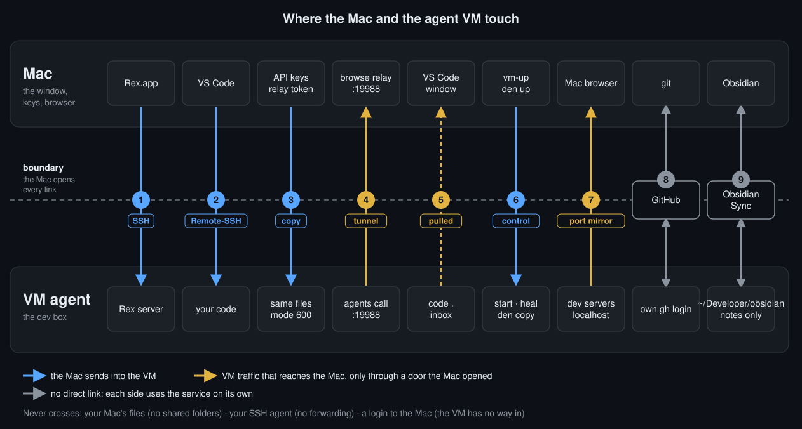
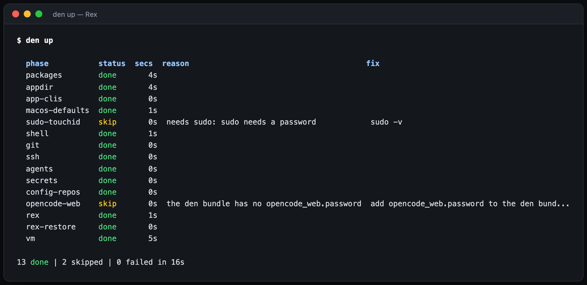
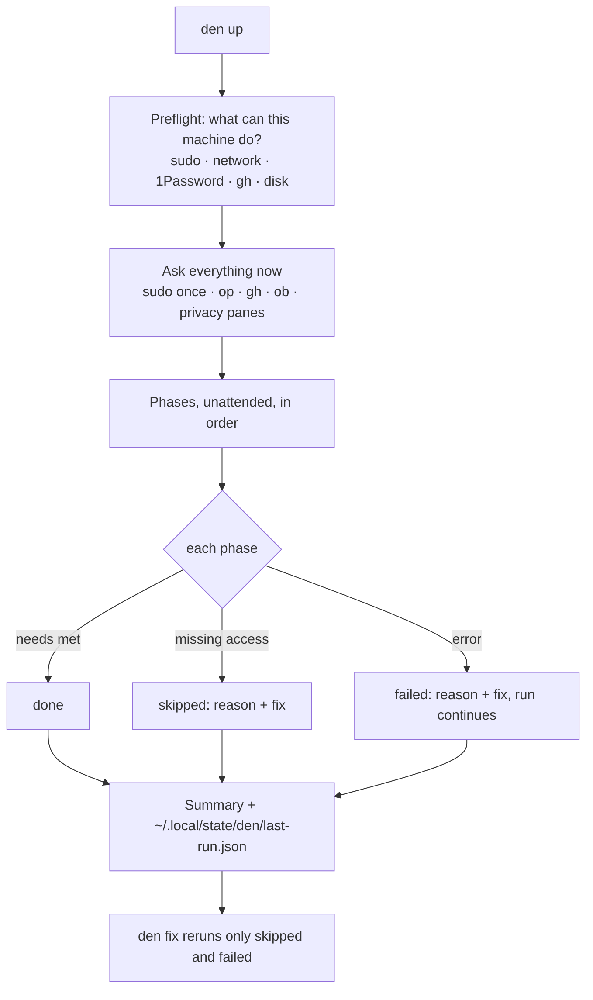

# den

One command sets up a Mac and its agent VM, then keeps both healthy. You answer every question in the first minute, walk away, and come back to a working machine.

<picture>
  <source media="(prefers-color-scheme: light)" srcset="docs/den/img/den-light.svg">
  
</picture>

The agents are wild animals: fast, strong, and not to be trusted with your Mac. So they live in a den, and you run it from the outside.

| In the picture | What it is in den |
| --- | --- |
| The den: thick walls, cage bars, no door | The Lima VM `agent`. You can see in; nothing gets out: no shared folders, no SSH agent, no way into the Mac. One exception, accepted on purpose: an open VS Code window on the VM (see [VM escape spec](docs/den/JAILBREAK.md)). |
| The wolf, the fox, the raccoon at its crate (orange, cyan, violet eyes) | The agents and their tools: Claude Code, OpenCode, Docker containers. |
| The server rack on the back wall | The Rex server, where your terminal tabs run. |
| The robot T-Rex at the console | You, on the Mac. Huge, but it steers the whole den with tiny arms on one lever: `den`. |
| The blue cable through the sealed gland | SSH: Rex and VS Code reaching in. The only wire, and it starts at your console. |
| The gold key cartridge, half-way into the feeding hatch | The only way keys go in: 1Password Document `den` → `~/.config/zsh/.api-keys.zsh` in the VM. |
| The green beacon | `vm-up`, the login agent that keeps the den alive and heals it. |

Everything that does cross the boundary is in [The bridges](#the-bridges). The picture is code: `node docs/den/scenes/den/build.mjs` (needs the `anatomy` skill).

## Why it is built this way

Coding agents run with few permission prompts. On a Mac, one wrong command from an agent can break the OS install, and on a managed Mac that can mean a wipe. So the agents live in a Lima VM, and the Mac is only the window, the keys, the browser and the VM host. A bad command in the VM can only damage the VM, and `den vm rebuild` gets you a new one.

The VM is a real dev box, not a jail: it gets every API key, its own GitHub login, Docker, and a synced copy of your vault. What it never gets is your Mac's files, your SSH agent, or a way into your Mac login.

There is one hole, accepted on purpose: **VS Code Remote-SSH**. When a VS Code window is open on a VM folder, VS Code trusts the VM, and a compromised VM can use that window to run a command on the Mac. This is how Remote-SSH works, not a bug in den. `docs/den/JAILBREAK.md` lists every path and the decision. The `code .` bridge itself is safe: it only asks the Mac to open a window on a path it validates.

## The bridges

The Mac and the VM touch in exactly these places. **The Mac opens every connection**: the VM cannot log in to the Mac, cannot read its files, and cannot start anything there except two things: browser actions through the browse relay (bridge 4) and a VS Code window (bridge 5). The one thing a VM process can reach on the Mac is the browse relay, through a tunnel the Mac opened.

<picture>
  <source media="(prefers-color-scheme: light)" srcset="docs/den/img/bridges-light.svg">
  
</picture>

| # | Bridge | Who opens it | What crosses | The guard |
| --- | --- | --- | --- | --- |
| 1 | Rex tabs | Rex.app, over SSH to `lima-agent` | your keystrokes and the terminal | the Rex server listens only on a Unix socket in the VM (mode 600); SSH is the only way to it |
| 2 | VS Code | VS Code Remote-SSH | files of the folder you open, **and commands the VM runs on the Mac** | the editor runs on the Mac, the files stay in the VM. **Accepted risk:** Remote-SSH trusts the VM. While a window is open, the VM can ask the window to run a command as you. See [JAILBREAK.md](docs/den/JAILBREAK.md) |
| 3 | API keys and the browse relay token | den and vm-up, with `limactl copy` | two files | mode 600; copied by `den up`, then by vm-up only when the content changes |
| 4 | Browser control | vm-up runs `rex forward` from the Mac into the VM | browse commands from VM agents to your browser | VM port 19988 reaches only the relay; the tunnel lives in its own Rex session `den`. Pair the browser with `browse pair` **on the Mac**: a code made in the VM never works, because the relay reads only the Mac's codes |
| 5 | `code .` | vm-up pulls the inbox over SSH | one folder path per line | absolute path only, 1024 characters max, no control characters, an immediate repeat of the same path within 10 s is refused, 5 opens a minute at most |
| 6 | Lifecycle | vm-up and `den up` | start and restart, the guest heal script, a copy of this repo | one way, Mac to VM |
| 7 | Dev servers | your Mac browser, through Lima | HTTP to `localhost:<port>` | only guest ports 1024-9999 are mirrored (not 19988), so dev servers open on the Mac but the VM can never take a Mac ephemeral port (49152-65535) that a CLI login waits on. The VM cannot reach Mac loopback services (`networkOpts.hostLoopback: false`). See [JAILBREAK.md](docs/den/JAILBREAK.md) |
| 8 | GitHub | each side on its own | code, through pushes and pulls | the VM has its own `gh` login; the Mac's SSH agent never goes in |
| 9 | Obsidian | each side on its own | notes | config sync is off in the VM (`--configs ""`), so it can never push plugins to the Mac |

The picture is code: `python3 docs/den/scenes/bridges/build.py`.

**What never crosses:** your Mac's files (no shared folders), your SSH agent (no forwarding), and your Mac login (the VM has no way in).

**What does cross at the VM's request:** browser actions through the relay (bridge 4), a VS Code window on a path the Mac validates (bridge 5), and — while that window is open — whatever commands the VM asks the window to run, which includes a terminal on the Mac (bridge 2). That last one breaks the isolation claim, and it is an accepted risk. Every path, with its evidence and control: [docs/den/JAILBREAK.md](docs/den/JAILBREAK.md).

## Quick start

On a fresh Mac:

```bash
curl -fsSL https://raw.githubusercontent.com/acastro2/mac-bootstrap/main/bootstrap.sh | bash
```

Stage 0 installs the Xcode Command Line Tools (they bring git), Homebrew, gum and jq, clones this repo, then runs `den up`. If git is still missing after that, it stops and says so.

On a Mac that already has this repo:

```bash
den up
```

**What you do in the first minute.** Preflight asks everything up front, so the rest runs while you are away:

1. Your password once for sudo. After the Touch ID phase, sudo asks for your finger instead, in Rex tabs too.
2. 1Password, if it is locked. den reads one Document, `den`, which holds every key.
3. GitHub login for the Mac and for the VM (each is its own login, so the VM never borrows the Mac's SSH agent).
4. Obsidian Sync login inside the VM, and which vault to sync.
5. The macOS privacy clicks that no script can make (see [Permissions](#permissions)).

Then every phase runs unattended. Each one ends **done**, **skipped** (with the reason and the exact command that fixes it), or **failed** (same). A failed phase never stops the run.



## The den command

| Command | What it does |
| --- | --- |
| `den` | Dashboard: the VM, the browse relay and the tunnel right now, then the last run and what to run next. |
| `den up [--only a,b] [--skip a,b] [--dry-run]` | Run the phases. `--dry-run` still runs preflight (in a terminal it can ask for sudo and sign you in), then lists each phase and what it needs. It runs no phase and writes `last-dry-run.json`, never `last-run.json`. |
| `den fix` | Run again only what was skipped or failed last time. |
| `den doctor [--strict]` | Read-only health: managed installs, host drift, permissions, the VM. `--strict` exits 1 when something is broken. |
| `den phases` | Every phase, its toggle, what it needs, what it does. |
| `den setup` | A short wizard that edits `config.env`. |
| `den secrets import <file>` / `den secrets status` | Use a `den.json` file when 1Password is not reachable. Import records the file; the next run that writes the keys deletes it. |
| `den vm up` / `down` / `shell` / `status` / `logs` / `rebuild` | The agent VM. `down` really stops it: it turns off both login agents first, so nothing starts it again. |
| `den permissions` / `den permissions fix` | The macOS privacy grants: check them, or walk the Settings panes. |
| `den clean [--dry-run] [--host-drift] [--yes]` | Remove only what den installed. `--host-drift` lists undeclared Homebrew leaves. It shows the plan and asks you to type `clean`. `--yes` skips that for den's own installs, never with `--host-drift`. |
| `den sessions export` / `import <file>` | Move agent chats to a new Mac. Import takes a snapshot first and never leaves you half-restored. |
| `den update` | `git pull --ff-only`, then `den up`. |


## Mac or VM: where each tool lives

The VM is the dev box. The Mac keeps what needs the Mac.

| Where | What |
| --- | --- |
| **Both** | Claude Code, OpenCode and their configs and skills, git, gh, the shell (zsh, Zim, starship, carapace, fzf, eza, bat, ripgrep, fd, jq, yq, neovim, gum), Rex Agent Restore, uv, ffmpeg |
| **Mac only** | 1Password, Rex, Lima, VS Code with Remote-SSH, the browse relay, Obsidian, Hex and the scribe stack, peekaboo, Rectangle, the desktop apps, shellcheck and bats for this repo |
| **VM only** | mise and every toolchain (Node LTS, .NET LTS, latest Go, Python, OpenTofu, pnpm), Docker Engine, kubectl, k9s, helm, awscli, the Snowflake CLI, PostgreSQL (latest), redis, Playwright, browser-use, asdf, opentunnel, the Rex server, Obsidian Headless |

`Brewfile` is the Mac list, `Brewfile.linux` is the VM list. `den doctor` on the Mac reports anything installed that the Mac `Brewfile` does not declare, with the command to remove it. A VM-only tool installed on the Mac counts as drift too. Nothing is removed until you run `den clean --host-drift` and confirm.

## How a run flows



The VM phase runs the same `den` inside the guest. It streams the Mac's checkout in first, so the guest always runs the same version as the Mac, with no push and no clone.

## Self-healing

A login agent, `io.mac-bootstrap.vm-up`, keeps the VM side working with nothing to remember.

| What breaks | How fast | What it does |
| --- | --- | --- |
| The VM stops or hangs after login | within 5 minutes | Starts it, with back-off, so a broken VM is never retried in a loop. |
| The VM is deleted | next check | Rebuilds it with the VM phase, at most once an hour. |
| The browser relay on the Mac is down | within a minute | Starts `browse serve`. |
| The tunnel from the VM to the relay stalls | within a minute | Probes it from the VM side and restarts it. |
| API keys or the relay token change on the Mac | within 5 minutes | Copies them into the VM (mode 600) only when the content changed. |
| A Node upgrade breaks the browse link, or the Rex server, Docker or vault sync stops | within 5 minutes | `vm/guest-heal.sh` repairs it inside the VM. |

`den vm down` is how you keep the VM off, because it turns the login agents off first. Logs: `den vm logs`.

## Secrets: one Document

Everything secret is in one 1Password Document named `den` (file `den.json`):

```json
{
  "version": 1,
  "env": { "OPENCODE_API_KEY": "...", "EXA_API_KEY": "..." },
  "opencode_web": { "password": "..." },
  "rex": { "appcast": "...", "mcp": "..." }
}
```

`env` becomes `~/.config/zsh/.api-keys.zsh` (mode 600, single-quoted, so a `$` in a key is never expanded). If 1Password is not reachable, put the file at `~/den.json` or run `den secrets import <file>`. den validates it and uses it. The run that writes the keys deletes the file and says so. den does not upload it anywhere: if 1Password does not hold the `den` Document yet, save it there before your next Mac. No secret is ever written to this public repo, a log, or a command line, with two exceptions: `opencode service set password` and the gated MCP URL passed to `claude mcp add`. Neither CLI takes the value any other way, so it shows in the process list for about a second.

## Permissions

macOS does not let any script grant privacy permissions without MDM, so den checks them and walks you through the required panes once. The browser and login-item rows are only reported, with the fix. Grant them to **Rex Server**, not to the Rex app, because every shell in a Rex tab belongs to the server.

| Grant | For |
| --- | --- |
| Rex Server: Full Disk Access | scribe reading Voice Memos |
| Rex Server: Accessibility, Screen Recording | peekaboo and browser control from a Rex tab |
| Hex: Microphone, Accessibility | dictation |
| Login items: vm-up, Lima | the VM starts at login |
| Browser: "Allow JavaScript from Apple Events" | browser control through Apple Events (View > Developer) |

den never enables Developer Tools mode, never calls `tccutil`, and never edits the TCC database. The research behind this, with sources: [docs/den/macos-permissions.md](docs/den/macos-permissions.md).

## Configuration

`config.env` is public and committed: identity, repos, and one toggle per feature. Put machine-only overrides in `~/.config/den/local.env`.

| Toggle | Turns off |
| --- | --- |
| `DEN_MACOS_DEFAULTS` | Dock, key repeat, Finder and dark mode settings |
| `DEN_TOUCHID_SUDO` | Touch ID for sudo |
| `DEN_REX` | the Rex app, its skill, Rex Agent Restore |
| `DEN_AGENTS` | the agent CLIs: a list (`opencode claude cortex`), or `0` to turn the phase off |
| `DEN_OPENCODE_WEB` | the OpenCode web UI on the tailnet |
| `DEN_VM` | the agent VM and its login agent |
| `DEN_BROWSE_TUNNEL` | VM agents driving the Mac browser |

To fork it: change `GIT_NAME`, `GIT_EMAIL`, `OP_VAULT`, the repo URLs and the toggles, create your own `den` Document, then run the one-liner with `REPO_URL` pointing at your fork.

## Rex, the window

Rex is the terminal. Its server runs in the VM, so a tab on the `vm` host is a zsh in Linux. Add the host once in the Rex app: press ⌘⇧P, run **Add Remote Host…**, enter `ssh://lima-agent` (`lima-` plus `AGENT_VM` from `config.env`), then **Switch Host**. den prints this reminder when it installs the Rex server, because the app keeps its own host list and refuses scripted actions unless Remote Control is on (it stays off, so no local process can drive the app).

## Moving to a new Mac

1. On the old Mac: `den sessions export`. It writes a mode-600 tarball to `~/.local/state/den/exports/`, and says to carry it by AirDrop or USB.
2. On the new Mac: run the one-liner, then `den sessions import <file>`.

Import checks every path in the archive, takes a snapshot of what it replaces, extracts to a temp folder, and only then swaps the files in. A bad archive leaves your current data untouched.

## When something goes wrong

- **A phase was skipped.** The summary has the fix command. Run it, then `den fix`.
- **`den doctor` shows host drift.** Something was installed outside the Brewfiles. Add it to the right Brewfile, or remove it with `den clean --host-drift`.
- **Certificate or proxy errors.** Corporate TLS inspection (Cisco Umbrella, Secure Access, GSA). Drop the CA bundle at `~/.config/corporate-ca-bundle.pem`; the shell exports it to Node, Python, curl, git and the AWS SDKs.
- **The VM is not coming back.** `den vm status`, then `den vm logs`. `den vm rebuild` starts over, and it asks you to type the VM name first.

## Working on den

Read [docs/den/CONTRACT.md](docs/den/CONTRACT.md) first: the rules every phase follows, the layout, and the hooks. Then [docs/den/JAILBREAK.md](docs/den/JAILBREAK.md): every path from the VM to the Mac, what closes it, and the risk we accepted on purpose. Each phase is one file in `lib/phases/`. Tests: `bats tests/` (CI also runs `shellcheck` on every script and `zsh -n` on the dotfiles). The pictures are code too: the den is `node docs/den/scenes/den/build.mjs`, the bridges are `python3 docs/den/scenes/bridges/build.py`, and the terminal shots are `docs/den/scenes/term/render.py` over real saved output (the file explains how to capture them).
