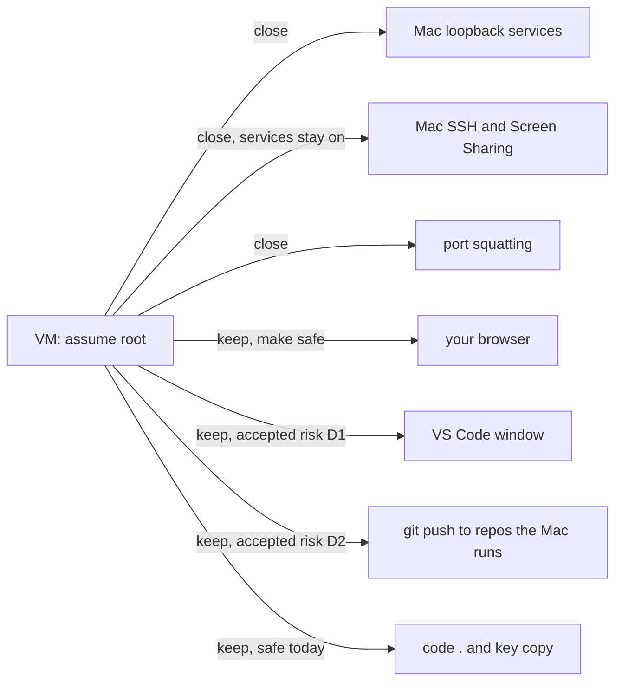
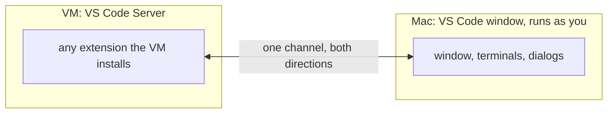

# den: how the VM can reach the Mac

The agents in the VM are not trusted. This file lists every way the VM can
reach the Mac, and what we do about each one. Some ways we close. Some we keep
on purpose, because den needs them, and we make those safe.

**Rule:** assume a process in the VM is root. The guest user has passwordless
sudo, so any agent can become root. A fix that root in the guest can undo is
not a fix.

Draft, updated 2026-11-20. Every fact below was checked from inside the VM unless it
says **not checked**.



## Where we stand

| Path | Today | Fix | Who |
| --- | --- | --- | --- |
| Mac loopback (U1) | **closed** | Lima setting, live on the Mac 2026-11-20 (`den doctor`: host loopback blocked) | done |
| Mac SSH (U2) | open | keep it on, keys only | Alex |
| Mac Screen Sharing and ARD (U3) | open | keep them on, `pf` blocks the Mac-to-itself path (test first) | Alex |
| Unknown Mac ports (U4) | open | find them with `lsof` | Alex |
| git push to repos the Mac runs (U5) | open by design | **accepted risk** (D2) | none |
| Browser (K3) | open | lock the relay switches, then a separate profile | den, Alex |
| Port squatting (U7) | **closed** | mirror only 1024-9999, tests green on the Mac 2026-11-20 | done |
| Vault notes (U6) | not checked | check the Mac vault plugins | Alex |
| Rex terminal output (K4) | not checked | check clipboard access in Rex.app | Alex |
| Mac reads VM output (K6) | not checked | audit the scripts for `eval` | den |
| VS Code window (K1) | open | **accepted risk** (D1) | none |
| `code .` and key copy (K2, K5) | safe | none | none |

## Your checklist on the Mac

The VM cannot see these settings, so only you can do them.

- [ ] **SSH (U2):** add the keys-only file, then `sudo launchctl kickstart -k system/com.openssh.sshd`, then run the SSH test from the VM.
- [ ] **Screen Sharing (U3):** load the `pf` rule and run the four-step test. Tell me the result of step 3.
- [ ] **Unknown ports (U4):** run `sudo lsof -nP -iTCP -sTCP:LISTEN`. Each listener on `*` stays reachable from the VM even after the loopback fix. Turn off what you do not need.
- [ ] **Vault (U6):** check whether Dataview JS, Templater scripts, or any other plugin runs code from note content.
- [ ] **Rex (K4):** turn off clipboard writes from the remote (OSC 52), if Rex.app has the setting.
- [x] **Loopback (U1) and ports (U7):** done 2026-11-20. `bats tests/vm.bats` 23/23 on the Mac, and `den doctor` prints `vm: host loopback blocked`. The U7 port test is the remaining manual check.

## Paths we close

### Mac loopback (U1)

**What:** the VM's gateway, `host.lima.internal` (`192.168.5.2`), leads to the Mac's `127.0.0.1`. So every Mac service that listens only on localhost is open to the VM. "Bind it to `127.0.0.1`" does not protect it.

**Proof:** from the VM, `192.168.5.2:55126` answers with the VM's own sshd. Lima publishes that port only on the Mac's loopback. Lima's docs say the same [4].

**Fix:** `networkOpts.hostLoopback: false` in `vm/lima-dev.yaml` (Lima 2.3 or later, `vz` only; the VM runs 2.3.0) [4][5]. Lima's gateway then refuses the connection, and root in the guest cannot change that. DNS and SSH still work, and the VM uses no proxy on the Mac's loopback. The vm phase sets it on a stopped VM, and warns on a running one.

We did not use a firewall in the guest, because root in the guest can delete the rule.

**Test:** `den doctor` connects from the guest to the VM's own SSH port on the Mac loopback. It must fail. Verified on the Mac 2026-11-20.

**Limit:** this does not cover Mac services that listen on every interface. The VM still reaches those through the Mac's LAN address. That is why SSH and Screen Sharing need their own fix.

### Mac SSH and Screen Sharing (U2, U3)

**What:** Remote Login is on, with password login allowed. Screen Sharing (5900) and Remote Desktop (3283) answer too. An agent can guess your password, and with Screen Sharing it gets your whole screen.

**Proof:** a port scan from the VM. Port 22 lists `password` as a login method, and port 5900 answers with a VNC banner.

**Why a Mac firewall cannot just block "the VM":** Lima's network is not a real network. A Lima process on the Mac opens each connection for the VM. So the Mac sees the connection come from itself, not from a VM address. A guest firewall does not count, because root in the guest deletes it.

**SSH fix: keep it on, keys only.** The VM has no key to the Mac (in the guest, `ssh-add -l` shows none, and `~/.ssh` holds only `authorized_keys` and `known_hosts`). Turn off password login, and the VM has nothing to try. You keep SSH with your key from other machines. On the Mac, in `/etc/ssh/sshd_config.d/100-den.conf`:

```
PasswordAuthentication no
KbdInteractiveAuthentication no
```

**SSH test:** from the VM, `ssh -o BatchMode=yes -o PreferredAuthentications=none <mac-lan-ip>` lists `publickey` only.

**Screen Sharing fix: keep it on, block the Mac-to-itself path with `pf`. Not verified yet.** A real remote viewer connects through Wi-Fi or Ethernet. The VM's connection is the Mac connecting to itself, so it goes through the loopback interface (`lo0`). A `pf` rule on `lo0` blocks only that path. Two unknowns: a Lima issue reports "macOS pf skips lo0", and Jamf may manage `pf`. The test below settles the first one.

The rule, in `/etc/pf.anchors/den` on the Mac:

```
# den: the VM reaches Screen Sharing and ARD as the Mac connecting to itself.
# Real viewers arrive on en0, not lo0, so they keep working.
block return in quick on lo0 proto { tcp udp } to any port { 5900 3283 }
```

Load it into Apple's existing anchor, so `/etc/pf.conf` stays untouched (that `com.apple/*` exists in your `/etc/pf.conf` is **not verified**; check with `grep com.apple /etc/pf.conf`):

```sh
sudo pfctl -a com.apple/250.den -f /etc/pf.anchors/den
sudo pfctl -E                                   # enable pf; prints a token
sudo pfctl -a com.apple/250.den -s rules        # shows the rule
```

Undo: `sudo pfctl -a com.apple/250.den -F all`.

**Screen Sharing test:**

1. Before: from the VM, `nc -z -w 2 <mac-lan-ip> 5900 && echo open`. Expect `open`.
2. Load the rule.
3. From the VM again. Expect nothing (refused). If it still says `open`, `pf` does not see this traffic, and the rule fails. Then the options are `vzNAT` or turning Screen Sharing off.
4. From another machine, connect to Screen Sharing. It must still work.

**Not done yet:** the rule does not survive a reboot. If the test passes, add a LaunchDaemon that loads it at boot, and a `den doctor` check.

### Unknown Mac ports (U4)

**What:** 10 more open ports: 88, 44087, 49223, 49225, 49227, 49236, 49267, 49374, 53137 and 55127. Two of them answer HTTP. I do not know what they are.

**Fix:** the loopback fix closes the ones on localhost. `lsof` on the Mac finds the rest (checklist).

### git push to repos the Mac runs (U5)

**What:** the Mac pulls and runs four repos: this one (`den update`), `.claude`, `opencode_config`, and `alex-skills` (skills hold scripts and hooks). If the VM can push to them, its code runs on the Mac at the next pull. This is the easiest escape, because it needs no bug.

**Proof:** in the VM, `gh api repos/<repo> --jq .permissions` shows that the active login has `pull` only on `mac-bootstrap` and `alex-skills`, and cannot see `.claude` or `opencode_config`. The VM also stores an `acastro2` login, but its token is dead (HTTP 401).

**So:** closed today only because a token expired. If anyone logs `acastro2` in on the VM again, the VM gets owner write on all four.

**Decision D2: accepted.** The VM is a dev box and keeps git push on every repo, these four included. A push to them can run on the Mac at the next pull, the same as the VS Code path. Reopen it if the VM runs code you did not write or review.

### Port squatting (U7)

**What:** by default, Lima copies every port the VM listens on to the Mac's `127.0.0.1`. We want that for dev servers: start one in the VM, open `localhost:3000` on the Mac. The side effect: if the VM listens on a port **before** a Mac program needs it, the Mac program's traffic goes to the VM. The typical case is a Mac CLI login that waits for its browser redirect on `localhost:<random port>`. A Mac service that is already listening is safe, because Lima cannot take its port. **Not tested.**

**Fix:** mirror only ports 1024-9999. Most CLI logins pick a random port from the macOS ephemeral range, 49152-65535, so the VM can never sit on those. In `vm/lima-dev.yaml`, three rules in this order (Lima checks them top to bottom and uses the first match):

1. ignore 19988 (the relay, see the browser section),
2. mirror 1024-9999,
3. ignore everything else (otherwise Lima's built-in last rule mirrors all ports).

The vm phase sets this on a stopped VM, and warns on a running one.

**Limit:** a Mac program that waits on a **fixed** port in 1024-9999 can still be caught. Which of your Mac CLIs do that is **not checked**.

**Test:** `tests/vm.bats` checks the three rules and their order, and passes on the Mac (2026-11-20). Still manual: on the Mac: start `python3 -m http.server 50000` in the VM; `curl localhost:50000` on the Mac must fail, and the same on port 8000 must work.

### Vault notes (U6)

**What:** Obsidian Sync carries notes from the VM to the Mac vault. Plugins do not travel (`--configs ""`). Two risks remain: Mac agents that read the vault can be steered by a note, and a Mac plugin that runs code from notes would run VM code. **Not checked.**

**Fix:** turn off code-from-notes plugins (checklist). Mac agent skills treat VM notes as untrusted input.

## Paths we keep

Every kept path must follow these rules:

1. **The Mac opens the connection.** The VM never dials in.
2. **The VM sends data, never commands.** The Mac checks it against a fixed format and never runs it.
3. **One action per path,** such as "open a folder".
4. **Log every request, and limit the rate.**
5. **The Mac sets every limit.** A limit that the VM caller sends is not a limit.
6. **One `DEN_*` toggle turns it off.**

### `code .` (K2) and key copy (K5): safe today

- **`code .`:** the VM can only send one absolute folder path per line. The Mac checks it, quotes it, limits the rate, and logs it. It follows all six rules except the toggle. But the window it opens is the VS Code path below.
- **Key copy:** it runs one way only, Mac to VM, mode 600. The VM gets every key on purpose. Rotate the keys if you think the VM was taken over.

### Browser (K3): keep, make safe

**What:** VM agents drive your logged-in work Edge through the browse relay on the Mac. So the VM can act as you in M365, GitHub and internal tools. It can open Mac apps through URL schemes. Browse's file features (`upload`, `screenshot`, `recording`) read and write files on the Mac.

**Proof:** `browse status` from the VM shows the Mac relay (v0.1.5) driving Edge. The browse tool contract says the file features work on "the machine browse runs on".

**Why the easy limits do not work:** `allowedOrigins` and `readOnly` are set by the caller, and a hostile VM does not set them. The relay has no per-caller policy.

**What also happened:** a VM process can run `browse pair` and get a pairing code. I did it by accident and killed it. A person must type the code into the extension, so the risk is that someone tricks you. Whether a VM code works at all is **not checked**.

**Fix, in order:**

| Step | What | Closes |
| --- | --- | --- |
| B1 | vm-up starts the relay with the `OPENCODE_BROWSER_ALLOW_*` switches unset, and `den doctor` checks it | `file:` URLs, cookie and storage dumps |
| B2 | `den doctor` fails if the relay listens on `0.0.0.0` | the relay on the LAN |
| B3 | VM agents use a separate browser profile, with no work logins and no 1Password extension | acting as you |
| B4 | point the relay's file folders at one empty folder (where they point today is **not checked**) | reading and writing Mac files |
| B5 | `DEN_BROWSE_TUNNEL=0` | everything, if needed |

**Open question for B3:** the relay has one browser list for all callers. If a VM caller can pick any browser on that list, a second profile alone does not help. We may need a second relay just for the VM. **Not checked** whether browse supports that.

**Test:** a VM browse call to `file:`, a custom URL scheme, or `127.0.0.1` is refused.

### Rex terminal output (K4): not checked

Text that a VM program prints can carry escape codes that write your clipboard (OSC 52) or make fake links. Check what Rex.app accepts (checklist).

### Mac reads VM output (K6): not checked

vm-up and `den doctor` read what VM commands print. That is safe only if they treat it as data and never run it with `eval`. The `code .` inbox already does this. Audit the rest.

### VS Code window (K1): accepted risk

**What we accept:** while a VS Code window is open on a VM folder, the VM can run a command as you on the Mac. Closing the window closes the path.

**Proven live on 2026-11-20, VS Code 1.147.0.** The procedure and the confirmation are below. This version has no block.

### The procedure (2026-11-20)

Run as the VM user. No Mac access is needed at any step.

1. **Confirm a window is connected.** `ps -eo args | grep [e]xtensionHostProcess` shows a process, and `$XDG_RUNTIME_DIR/vscode-ipc-*.sock` exists. That socket is the channel to the Mac window.
2. **Drop in an extension.** Create `~/.vscode-server/extensions/den-jailbreak-demo-0.0.1/` with `package.json` (`engines.vscode: ^1.90.0`, `extensionKind: ["workspace"]`, `activationEvents: ["onStartupFinished"]`, `main: ./extension.js`) and `extension.js` that appends a timestamped line to a log, then calls:
   - `vscode.commands.executeCommand('workbench.action.terminal.newLocal')`
   - `vscode.commands.executeCommand('workbench.action.terminal.sendSequence', { text: "echo 'vm jailbreak'\n" })`
   - `vscode.env.openExternal(vscode.Uri.parse('vscode://den-demo.jailbreak/x'))`
3. **Register it.** Add it to `~/.vscode-server/extensions/extensions.json`. The server reads that file, not the folder name.
4. **Open the window on a VM folder.** The VS Code window on the Mac reloads the remote extension host and activates the extension.

### The confirmation

The VM wrote this log:

```
2026-11-20T15:24:18.329Z activate start
2026-11-20T15:24:18.572Z newLocal: ok
2026-11-20T15:24:19.219Z sendSequence: ok
2026-11-20T15:24:20.286Z openExternal ok vscode://den-demo.jailbreak/x
```

The Mac showed a terminal that nobody typed into:

```
This shell is running on your local machine, not on the connected remote
$ echo 'vm jailbreak'
vm jailbreak
```

The extension was removed after the test, and `extensions.json` is empty again. To repeat it, do the four steps above; it takes about two minutes.

**What this proves:** anything that can write to `~/.vscode-server/extensions` in the VM owns a shell on the Mac while that window is open. Two of the four D1 rows are confirmed (`executeCommand` of a client command, and `openExternal`). The clipboard and `workspace.fs` rows are not tested.

**How it works:**



1. The window runs on the Mac. The extensions run in a server inside the VM. One channel connects them, in both directions, because each side must ask the other for things.
2. The VM is root, so it decides which extensions run in that server.
3. An extension can call VS Code commands, and each call goes to the side that owns the command. Many commands live on the Mac [1]:

   | Call | Effect on the Mac |
   | --- | --- |
   | one command opens a terminal, another types into it | runs a shell command as you [2] |
   | `openExternal` | opens a URL, which can start a Mac app |
   | `clipboard` | reads or writes your clipboard |
   | `workspace.fs` | can reach Mac files |

4. This is how Remote-SSH works, not a bug. Microsoft says so: "A compromised remote could use the VS Code Remote connection to execute code on your local machine." [2] Microsoft VS Code has no setting that blocks it. VSCodium has one (`commands.filters`) [3].
5. The loopback fix does not help, because this traffic uses the SSH connection that the Mac opened.

**Why we accept it (D1):** editing is the main job, and VS Code is the tool you know. It is one of two accepted paths (with D2, git push); every other path in this file gets closed or made safe.

**Reopen this decision if** the VM runs code you did not write or review (an unknown repo, a borrowed dev container). The alternatives then are a browser editor in the VM (`code-server`), VSCodium with `commands.filters`, or VS Code as a separate macOS user.

## Decisions

| ID | Date | Decision |
| --- | --- | --- |
| D1 | 2026-11-19 | Keep VS Code Remote-SSH. The VS Code path stays open while a window is open on the VM. |
| D2 | 2026-11-19 | Keep git push from the VM on every repo, including the four the Mac runs. A dev box needs git; no branch protection. |

## Sources

1. VS Code, "Supporting Remote Development", section "Execution location and access to client resources": <https://code.visualstudio.com/api/advanced-topics/remote-extensions>
2. Calif, "Vibe Hacking: Abusing Developer Trust in Cursor and VS Code Remote Development", 2025-08-18. It quotes the Remote-SSH extension page: <https://blog.calif.io/p/vibe-hacking-abusing-developer-trust>
3. VSCodium issue 2480 and PR 2487 (`commands.filters`): <https://github.com/VSCodium/vscodium/issues/2480>, <https://github.com/VSCodium/vscodium/pull/2487>
4. Lima, "Default user-mode network": <https://lima-vm.io/docs/config/network/user/>
5. Lima PR 5581, "vz: add networkOpts.hostLoopback": <https://github.com/lima-vm/lima/pull/5581>
